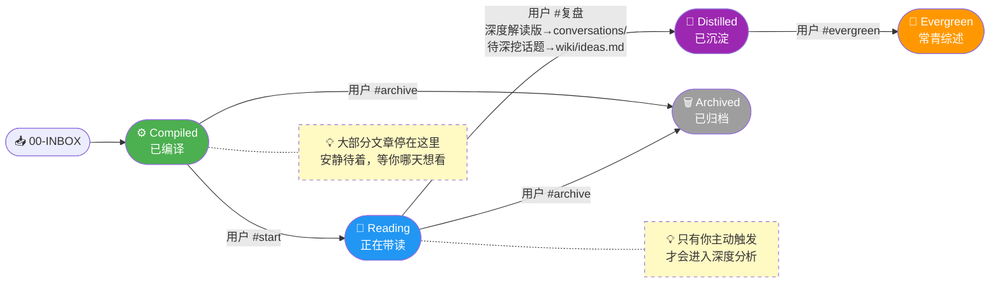
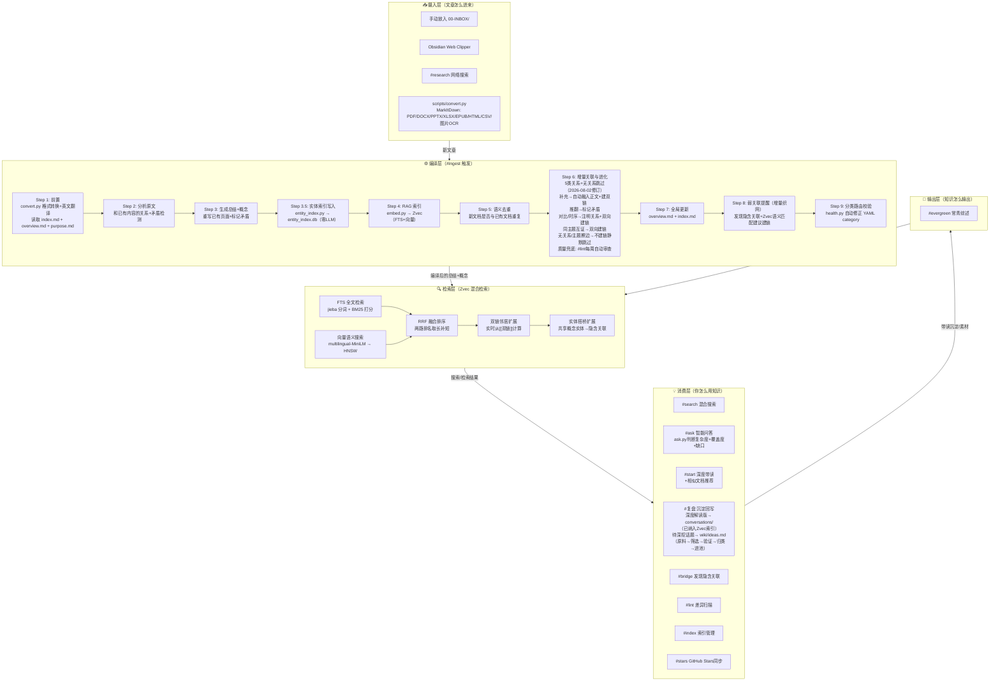
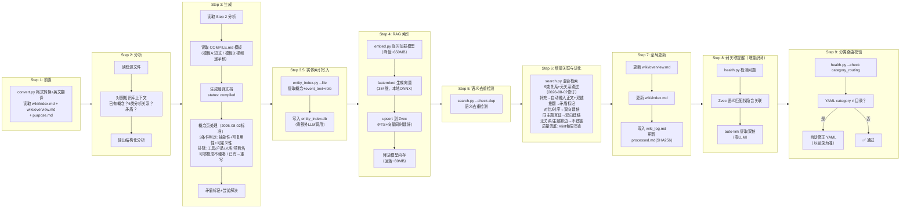
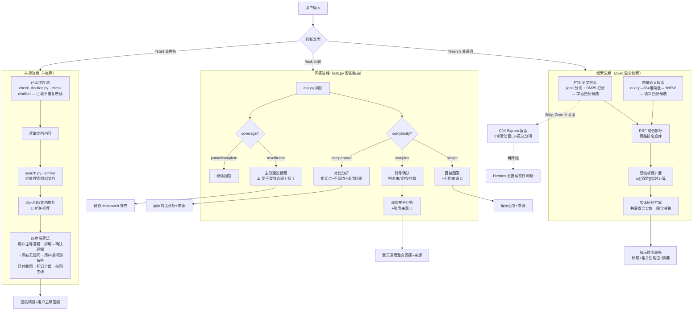
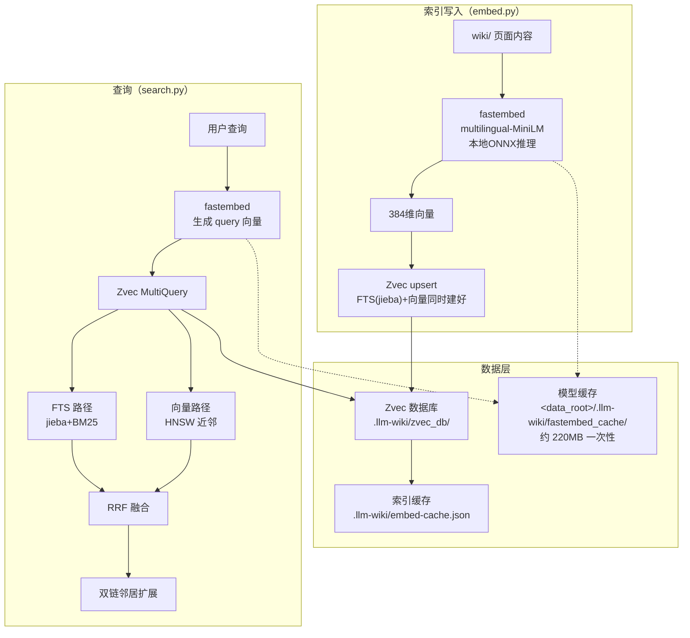
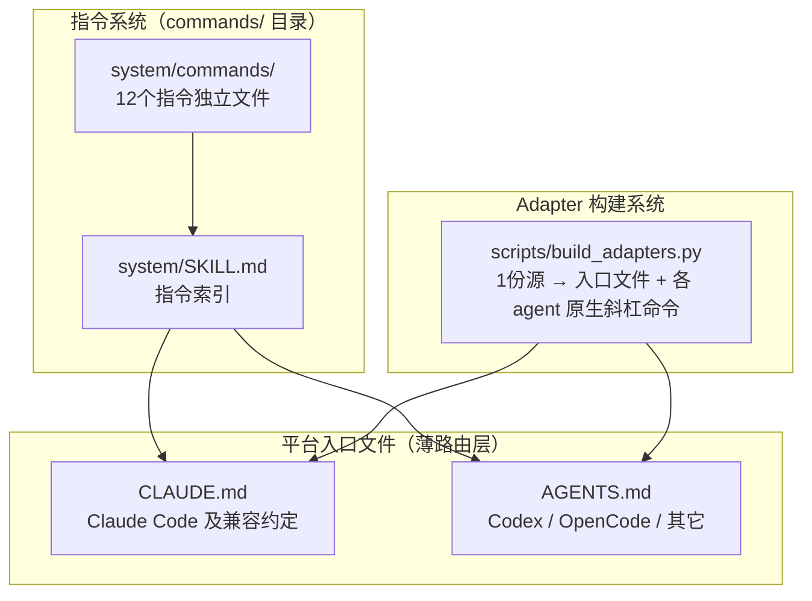
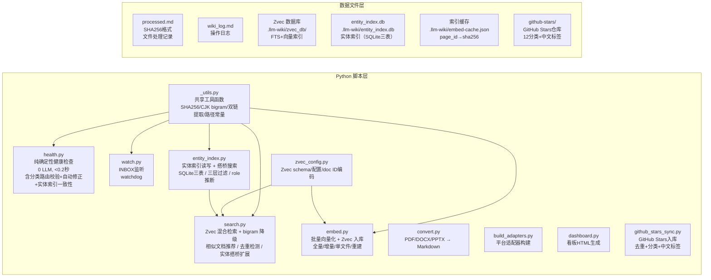
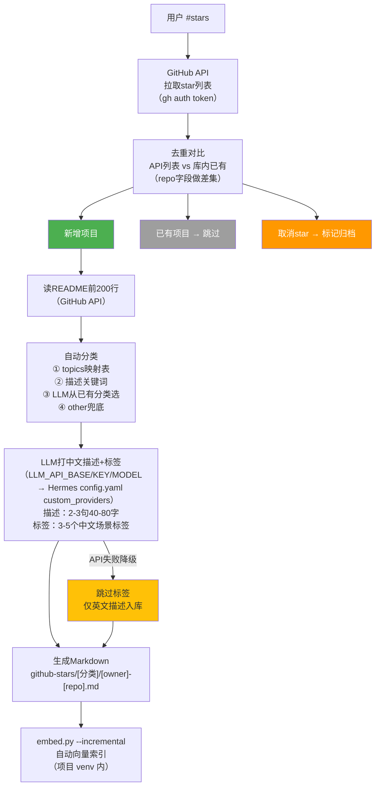
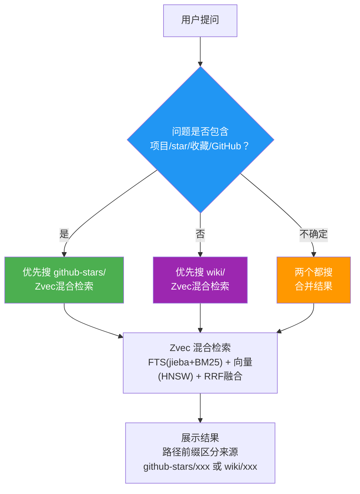
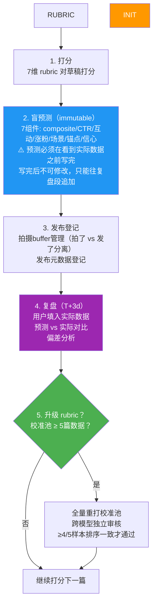

# 流程图与架构图: LLM Wiki 能力升级

>
> ⚠️ **维护提醒**：wiki 项目有增删或调整时，必须同步更新以下两个文档：
> - `upgrade-todo/quickstart.md` — 使用指南（指令表、场景示例、FAQ）
> - `upgrade-todo/flowcharts.md` — 流程图与架构图（编译流程、搜索流程、脚本层）

---

## 一、文章状态流转图

一篇文章从"放进知识库"到"完全内化"的完整生命周期。



**人话版**：

```
放文章进来 → #ingest 编译（自动格式转换+生成总结+RAG索引+去重检测）（状态：compiled）
                │
                ├── 想深度看 → #start（自动推荐相似文档）→ 带读 → #复盘 → 深度解读版写入conversations/（已纳入Zvec索引）+ 待深挖话题五步流程（原料→筛选→验证→归类→进池）→ 沉淀完毕（distilled）
                │                                                              │
                │                                                              └── 可选 → #evergreen → 常青综述
                ├── 不想看 → #archive → 归档（archived）
                │
                └── 暂时不管 → 安静待着，不打扰你
```

---

## 二、整体架构图

改造后的系统长什么样，各部分怎么配合。



---

## 三、编译流程图（含 RAG 索引）

编译一篇文章时，AI 内部怎么走。



**人话版**：

```
旧流程（一锅炖）：
  AI 读完原文 → 直接生成总结 → 完事
  问题：不知道知识库里已有什么，容易重复或遗漏

新流程（十步走）：
  Step 1：AI 先做前置（convert.py 格式转换+英文翻译+读取知识库上下文：已有概念、overview、purpose）
  Step 2：AI 分析"这篇文章讲了什么，和已有知识什么关系，有没有矛盾"（6类分析关系：引用/补充/推翻/对比/时序/包含层级）
  Step 3：AI 基于分析生成总结，概念页按2026-08-02判定标准处理（3条件：抽象性/可复用性/可定义性；排除工具/产品/人名/项目名；可零概念不硬凑），已有概念重写而非追加，矛盾标记
  Step 3.5：entity_index.py 写入实体索引（概念+一句话概括+core/mention角色，零LLM）
  Step 4：embed.py 自动生成向量入库 Zvec，编译完立刻可搜
  Step 5：检测新文档是否和已有文档语义重复，提醒合并
  Step 6：增量关联与进化——5类关系全自动处理+无关系跳过（2026-08-02修订）：
    补充→已有文档正文自动融入新信息（重写对应段落）+双向建双链
    推翻→矛盾标记，提示 #lint
    对比→双向建双链+注明"不同角度"
    时序→双向建双链+注明"后续发展"
    同主题互证→双向自动建双链+注明"同主题互证"
    无关系/主题擦边→不建链，静默跳过
    质量兜底：#lint 每周自动审查最近7天自动进化内容，发现问题自动修正
  Step 7：自动更新 overview/index/log
  Step 8：弱关联提醒（增量织网）——发现隐含关联、Zvec 语义匹配建议建链、提取双链
  Step 9：分类路由校验——YAML category 与目录不一致则自动修正

  好处：AI 知道知识库已有"注意力经济"，不会重复创建"注意力"概念
  好处：编译完立刻能搜到，不用等
```

---

## 四、搜索与问答流程图

从输入关键词到获得答案的完整路径。



**人话版**：

```
#search（搜文档）：
  你输入关键词 → Zvec 混合检索（jieba FTS + 向量 + RRF）→ 双链邻居扩展 → 实体搭桥扩展 → Top-5
  例子：搜"信息过载"→ FTS 找字面匹配 + 向量找语义匹配 → RRF 融合 → 双链扩展关联文档 → 实体搭桥发现共享概念的文档 → 能找到"认知Commons"和"慢速内容"

#ask（问问题）：
  你提问 → ask.py 问诊（检索+复杂度判断+覆盖度评分+缺口检测）
    simple（"X是什么"）→ 直接回答+引用来源
    complex（"怎么做XX"）→ 先引导确认（列出来/文档/步骤）→ 深度整合回答
    comparative（"X和Y什么关系"）→ 对比分析（相同点+不同点+适用场景）
    coverage不足 → 主动建议"要不要我去网上搜一下？"

#start（带读）：
  你指定文件 → check_distilled.py 已沉淀过滤（distilled 拦截）→ 确认开始带读时 --mark 打标记 → 读内容 → 向量搜索相似文档 → 实体搭桥扩展 → 四步带读法（用户主导答疑，延伸分流，复盘统一处理）

搜索架构（已上线）：
  四级流水线：Zvec 混合检索（FTS+向量+RRF）→ 双链邻居扩展 → 实体搭桥扩展 → Top-K
  实体搭桥：从搜索结果提取概念实体，SQL join 找共享实体的其他文档，三层过滤（≥2共享实体/1共享+双方core/高频降权）
  降级链：Zvec+双链+实体搭桥（完整）→ Zvec+双链（实体索引缺失，自动跳过搭桥）→ Zvec（无双链，仅混合检索）→ bigram（+双链扩展）→ Hermes 直接读文件判断（Agent 层兜底），多级降级不会报错

6个 RAG 能力：
  ① 语义搜索 — #search 自动生效
  ② 相似文档推荐 — #start 带读时自动触发（含 GitHub Stars 项目推荐，带⭐标识）
  ③ 智能问答 — #ask ask.py判断复杂度（simple/complex/comparative），覆盖不足主动建议搜索
  ④ 语义去重 — #ingest 入库时自动检测
  ⑤ 增量关联与进化 — #ingest 入库时自动检测5类关系（补充/推翻/对比/时序/同主题互证）+无关系跳过（2026-08-02修订），全自动执行，#lint每周审查兜底
  ⑥ 实体搭桥扩展 — #search/#ask/#start 自动生效，通过共享概念实体发现双链没覆盖的隐含关联
```

---

## 五、RAG 技术架构图

搜索底层的技术实现。



**关键参数**：

| 参数 | 值 | 说明 |
|------|---|------|
| Embedding 模型 | multilingual-MiniLM-L12-v2 | 384维，中英混合好，区分度0.48 vs 0.09 |
| 向量索引 | HNSW + COSINE | Zvec 内置，无需配置 |
| FTS 分词 | jieba | Zvec 内置，比 bigram 精准 |
| 融合算法 | RRF (rank_constant=60) | Zvec 内置 RrfReRanker |
| Doc ID | doc_+MD5(page_id)[:8] | Zvec 不支持中文 ID，用哈希编码 |
| 模型内存 | 峰值~650MB，释放后~80MB | 临时加载，用完 gc.collect() |
| 搜索速度 | ~3s（含 query embedding） | 主要耗时在模型加载 |

---

## 六、文件组织与平台适配

指令系统和多 Agent 平台适配的架构。



**人话版**：

```
改指令：只改 system/commands/xxx.md 一个文件
新增指令：加一个 .md + 更新 SKILL.md 索引
换 Agent：加一个薄路由文件，或运行 build_adapters.py 自动生成
开源时：build_adapters.py 加新平台 adapter 配置即可
```

---

## 七、基础设施层

支撑整个系统运行的底层脚本。



---

## 八、GitHub Stars 同步流程图

`#stars` 触发时，从GitHub API到本地入库的完整路径。



**人话版**：

```
#stars 触发 → 拉GitHub API → 对比库里已有的 → 三种情况：
  新增的 → 读README → 自动分类 → LLM打中文描述+标签 → 生成md → 更新索引
  已有的 → 跳过（零token）
  取消star的 → 标记归档

增量更新：只有第一次全量，后续只处理新增的几个项目

⚠️ 动作分类移动/整改（把已有项目从 A 分类挪到 B 分类）后：
   必须 python scripts/entity_index.py --rebuild 重建实体索引
   （stars 常规同步只写 Zvec 向量、不写 entity_index；不重建会留 死行 + 新路径失联）
   验证：python scripts/health.py --check entity_index → 应输出 Entity index OK
```

---

## 九、检索策略区分图

用户提问时，Agent如何判断搜wiki还是搜github-stars。



**检索命中维度**（描述和标签互补）：

| 搜索方式 | 命中维度 | 举例 |
|---------|---------|------|
| FTS关键词 | 标签 + 描述 + topics | 搜"小红书运营" → 命中标签 |
| 向量语义 | 描述 + 标签 + 全文 | 搜"视频制作" → 语义匹配"视频生成" |
| 描述兜底 | 中文描述 | 搜"批量渲染" → 命中描述里的场景词 |
| 标签兜底 | 中文标签 | 搜"求职" → 命中标签"面试准备" |

**GitHub Stars文档结构**（每个md文件）：

```
---
title: 项目名
type: github-star
repo: owner/name          ← 去重key
category: ai-agents       ← 分类目录
tags: [标签1, 标签2, ...]  ← 中文场景标签（LLM生成）
---
# 项目名

英文描述（原文）
中文描述（LLM生成，2-3句，覆盖核心功能+适用场景+用户群体）

🔗 [GitHub](https://github.com/xxx/yyy)
```

---





```
       ↓
       ↓
       ↓
发布后 "复盘" → T+3d数据回收 → 预测vs实际对比
       ↓
积累5+篇 → "升级rubric" → 校准池全量重打 + 跨模型审核
```


| 原因 | 说明 |
|------|------|
| 完整5阶段闭环 | 打分→预测→发布→复盘→进化rubric，阉割成YAML字段会丢失核心能力 |
| immutable日志 | 预测是独立文件不可修改，写进脚本YAML会破坏不可变性 |
| rubric进化 | 校准池全量重打+跨模型审核，需要独立状态管理 |

**三条不可妥协原则**：
1. **盲预测**：预测必须在看到实际数据之前写完，写完不可修改
2. **升级=全量重打**：rubric升级时校准池所有有实绩数据的样本必须用新公式重打
3. **rubric是工作台不是博物馆**：被新数据推翻的观察直接删掉，不留考古层
