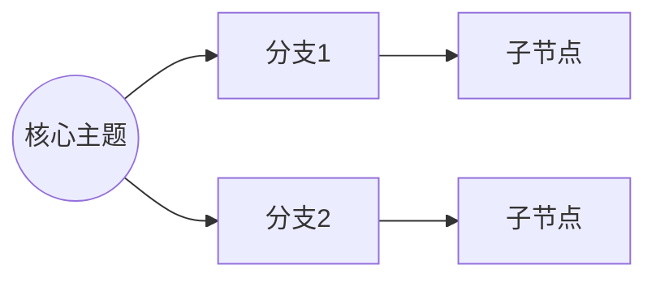

# 🔄 知识库反哺与对话存档：`#复盘` 或 `#总结`

**触发时机**：用户在任何阶段发送 `#复盘` 时。立即终止探讨并结案。

**核心理念**：复盘产出的深度解读版 = **比 summarize 更丰富、更易消化的学习文档**。
- summarize 是忠于原文的结构化摘要，**复盘不改 summarize**
- distill 是按认知逻辑重新组织的深度解读，带可视化+个人对照+素材标注
- 目标：**看解读版就够了，不需要再回去看原文或 summarize**

**写入位置**：深度解读版写入 `wiki/conversations/` 下的 Chat 文件，**不写入 summarize 源文件**。源文件沉淀区只保留指向 Chat 文件的链接。

**织网不在复盘里做**：关联发现是 `#bridge`（`#织网`）的职责，需要用户手动触发。复盘不越权自动织网。

**结构自适应原则**：以下板块根据内容特点决定是否输出，不强凑：
- 思维导图：**必写**，任何内容都能画
- 流程图：有核心机制/因果链/循环才画，纯概念解释类不用硬凑
- 深度解读：**必写**，核心板块
- 对话增量：有对话新产出才写，纯原文解读可省略
- 素材速查：有 `🎬[素材]` 标注才写，纯技术文档可能没有

**【⚙️ 分步执行指令 (降压处理)】**：必须分两步汇报：
- **动作一（后台建档）**：优先完成深度解读版写入 Chat 文件，发送临时提示：`[⏳ 正在压缩本次对话的知识结晶并生成深度解读版，请稍候...]`
- **动作二（源文件反哺）**：更新源文件状态机 + 沉淀区链接。

**执行动作**：
1. **写入深度解读版**：在 `wiki/conversations/` 下新建 `[源文件标题_Chat_当前日期].md`，写入完整的深度解读版，结构如下：

```markdown
---
source: "源文件标题"
date: {{当前日期}}
type: distill
---

# 深度解读版：源文件标题

## 🧭 思维导图
（**必写**。用 mermaid flowchart LR 模拟思维导图，左到右树状结构，干净无色块。
不要用 mermaid mindmap——Obsidian渲染效果差，色块堆叠不清晰。

**数据来源**：思维导图综合以下内容生成——
- 📝 编译版（summarize）的结构化知识点 → 构成主干分支
- 💬 对话深化产生的修正/补充 → 融入对应分支（与编译版合并，不单独标注）
- 👤 用户经历验证 → 融入对应分支

**组织策略**——根据内容类型选择合适的逻辑骨架：
- **方法论/实操类**（如反愿景协议、习惯养成）：按 为什么→是什么→怎么做→不适用场景
- **概念解释类**（如控制论、目的论）：按 定义→核心要素→运作机制→与其他概念的关系
- **观点论述类**（如自律神话、知识重构）：按 核心论点→支撑论据→适用边界→反例
- **框架模型类**（如9级自我发展、力场6组件）：按 整体结构→组件拆解→运作逻辑→应用场景
- **混合类**：按认知逻辑自由组织，不跟着原文章节走

分支控制在5-8个一级分支，每个分支2-4个子节点，不要过度展开）



## 🔀 核心逻辑流程图
（**可选**。有核心机制/因果链/循环才画，纯概念解释类不用写。
mermaid flowchart 格式，选择最适合的图表类型：流程图/循环图/时序图/状态机。
1-2个图，覆盖最核心的1-2个机制即可，不要试图图解所有内容）

## 📖 深度解读
（**必写**。按认知逻辑重新组织的完整解读正文。不是摘要，是**解构后重建的学习文档**。）

**写作要求**：
- **重新组织**：按"为什么→是什么→怎么做→什么情况不适用"的认知逻辑重新编排，不跟着原文章节走
- **比 summarize 更通俗**：summarize 忠实还原，深度解读要让人一看就懂。用比喻、类比、大白话解释抽象概念
- **融入对话中的更精准理解**：对话中对原文框架的修正、补充、验证，直接融入解读正文，标注 `[💡对话深化]`
- **来源归属**：原文框架标注 `[原文]`，对话推演标注 `[💡对话深化]`，用户经历验证标注 `[👤用户验证]`
- **观点标注**：解读正文中，遇到"反直觉/高共鸣/可独立展开"的观点或比喻，用 `💡[观点]` 标注，并附一句话说明为什么值得单独想
- **克制深度**：这是学习文档不是学术论文，点到即止，不要过度展开
- **章节分隔**：每个小节之间用 `---` 分隔线，增强视觉节奏感

## 💬 对话增量
（**可选**。对话中产生的、原文没有的有价值内容才写。和解读正文严格区分。

**写入规则（双门槛：与本文主题相关 + 有价值）**：
- 用户个人经历对照及验证 → 写这里，不写进解读正文
- 对原文框架的质疑和修正理由 → 写这里（解读正文只写修正后的结论）
- 跨领域类比和延伸 → **仅当延伸与本文主题相关**才写这里
- **与本文主题无关的延伸 → 不进本区**，写入下方的 `🧭 延伸话题` 板块
- 判据一句话：**对话增量区的准入门槛 = 与本文主题相关 + 有价值，两条都满足才进，缺一条不进**
- **严格区分**：原文有的内容→进解读版，对话新产生的→进增量区）

## 🧭 延伸话题
（**可选**。带读/对话中产生的、**与本文主题无关**但单独有价值的话题。作为后续养料保留，不污染解读正文和对话增量区。

**写入规则**：
- **自动识别（必需机制，不需用户 cue）**：复盘时从完整对话历史自动识别有价值的延伸话题——AI 判定归属（相关→对话增量/无关有价值→本区+库/无价值→不沉淀），用户无需在带读中要求"记一下"
- 每条含：话题名 + 源自哪个模块/讨论 + 状态（默认"待深挖"）+ 一句话价值描述
- 与本文主题相关的延伸 → 不进本区，进上方 `💬 对话增量`
- 无价值延伸 → 不记录
- **同步延伸话题库（必做）**：写本板块的同时，将每条**同步追加**到 `wiki/ideas.md`（带双链指向本 Chat 文件 + 价值描述）——集中视图供用户查看、AI 检索（wiki/ideas.md 已在索引内），防分散在 Chat 文件被忽略
- **按需升级**：不预建独立文件。用户之后真正想深挖某话题时，才升级为独立文档（有独立展开价值的）或独立文档（纯知识性的，走 #ingest 编译）——升级时在库中将该条状态改为"已升级"，并双链指向产物；一直没碰则安静留在本区，不占目录不污染任何内容
- 示例：
  ```markdown
  ## 🧭 延伸话题

  1. **更新力场** — 源自本次讨论 | 状态：待深挖
     → 价值：xxx | 类型：观点型
  2. **某概念** — 源自【模块四】讨论 | 状态：待深挖
  ```）

## 🎬 素材速查
（**可选**。从解读正文中提取所有 `🎬[素材]` 标注，汇总成列表。没有素材标注就不写此板块）
1. **素材点标题** — 切入角度：xxx | 源自：页内跳转至对应章节标题

## ⚠️ 私货排除区
（**可选**。#start 价值预判识别出营销/私货内容时写。**禁止沉淀进解读正文/对话增量/概念页**——私货内容本身不入库为知识，只记录"排除决策"防误用）
```markdown
## ⚠️ 私货排除区（不可作为创作素材）
> 本篇 X% 内容为营销（xxx推广，集中在第N节）：
> - ❌ 排除（工具推广/带货/求star）：xxx
> - ✅ 保留（有独立外部背书的知识）：xxx
> - 原因：排除项为推广无独立知识价值；保留项可脱离推荐物独立成立
```

```

2. **修改源文件状态机**：将源文件 YAML 的 `status` 改为 `distilled`，交互次数+1，更新 `last_interacted` 为当前精确日期。**价值预判回填**：若带读时识别出营销/私货（🟡/🟠/🔴），在源文件 frontmatter 回填 `intent: knowledge|marketing|mixed` + `marketing_ratio: X%`（无私货不写，默认纯知识）。该标记供日后内容创作时识别：`marketing` 不采用、`mixed` 仅取知识部分（以 Chat 文件私货排除区为准）。
3. **源文件沉淀区更新**：在源文件底部的 `## 🗣️ 知识副驾对话沉淀` 处，**只写入指向 Chat 文件的链接**，不写入解读内容：
   ```markdown
   ## 🗣️ 知识副驾对话沉淀

   > 📂 深度解读版存档于：对应的Chat文件名称（双链）
   ```
4. **（本开源版本已移除）衍生选题流程**：本版本不含内容创作模块。
   复盘产出的「延伸话题」仍会写入 `wiki/ideas.md`（见板块 3），作为**待深挖灵感池**；
   想成稿时从其中手动挑选即可。
5. **系统打卡**：在 `wiki_log.md` 底部追加 `[- [{{当前精确时间}}] 🔄 DISTILL: 完成了文章 源文件名 的深度复盘，对话已存档]`
6. **双链更新**：复盘后新增的双链会在下次搜索时自动生效（实时计算邻居关系，无需额外步骤）。

**前台回复规范**："🔄 知识飞轮转动成功！深度解读版已写入 Chat文件名，源文件状态已更新为 `distilled`。请问今天要继续看下一篇待办，还是休息一下？"
